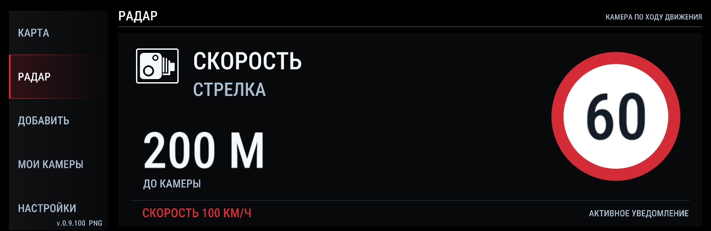
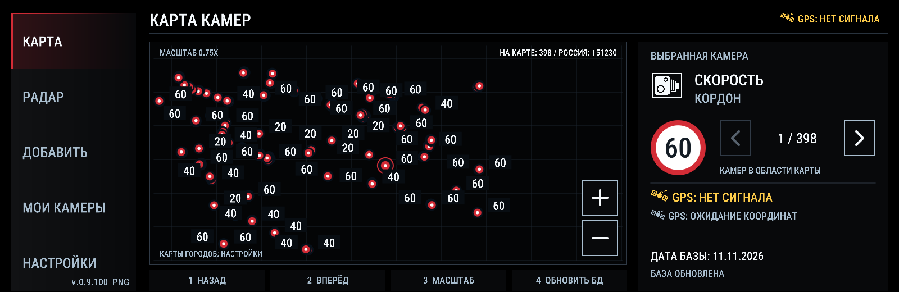
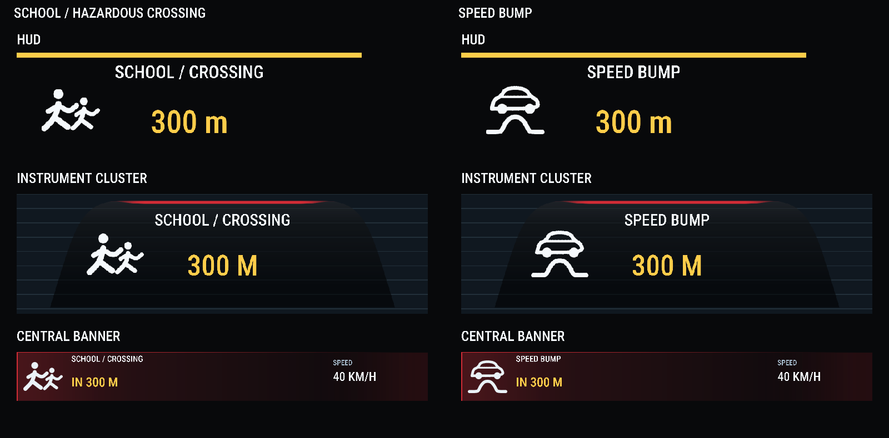
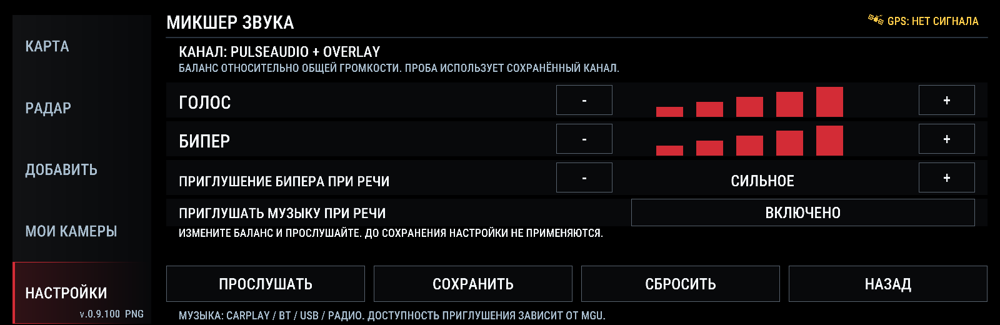

# SpeedCAM

### Cameras ahead. Information where you need it.

**Camera alerts for BMW MGU ID7 — on the central display, head-up display and instrument cluster.**

[**Download SpeedCAM**](https://github.com/skalitov-bit/bmwcaminfo/releases/latest) · [**Camera database**](https://github.com/skalitov-bit/speedcam-db/releases/latest) · [**Support the project ♥**](https://pay.cloudtips.ru/p/93ccdd74)

**Free · MGU Store installation · Offline camera alerts · English & Russian**

SpeedCAM brings camera information to your BMW's own displays: the type of control, the camera model when available, the speed limit and the remaining distance. A clear radar view, voice prompts and an accelerating beeper help you follow the road ahead.

**Current release: 0.9.100 gps test version · Audio service: 0.1.50.** [Release notes →](https://github.com/skalitov-bit/bmwcaminfo/releases/latest)

[Features](#features) · [Countries](#camera-database-27-countries) · [Screenshots](#screenshots) · [Installation](#installation) · [Support](#support-speedcam)

## Features

| Feature | What it does |
|---|---|
| **Alerts along your path** | Uses direction and the predicted driving trajectory, including curves, to select relevant points. Real cameras take priority over dummy cameras. |
| **Speed-aware warning distance** | In automatic mode, higher approach speeds trigger earlier warnings. |
| **Rear-facing cameras** | Shows a rear-facing warning when this information is available and retains monitoring for 100 m after passing the camera. |
| **Three display options** | Central-screen radar, compact HUD alerts and an instrument-cluster banner with its own translucent backing. HUD position and its top line are adjustable. |
| **Voice and beeper** | English and Russian voice prompts, eight beeper sounds, separate voice/beeper levels and a music-ducking option. Simultaneous playback is supported by the mixing audio modes. |
| **Choose each alert type** | Separate checkbox lists for visual banners and voice prompts. School/crossing and speed-bump alerts are available but disabled by default. |
| **Your own points** | Add personal cameras or exclude a camera from alerts. Exclusions survive camera-database updates. |
| **Independent database updates** | Update the camera database inside the app without installing a new application version. |
| **Downloadable road maps** | Install, update or delete only the regions you need. Road maps are separate from the camera database. |
| **Maps on HDD** | When a compatible writable HDD is detected, the app offers to move downloaded maps, verifies their integrity and raises map storage capacity to 4 GiB. |
| **BMW controls** | Touch and iDrive controller support, large Roboto Condensed text, dark backgrounds and red accents. |

Supported categories include speed cameras, red-light and stop-line cameras, traffic-rule and bus-lane enforcement, average-speed control, police posts, school/crossing warnings and speed bumps. The available details depend on the individual database record; unknown models and limits are not invented.

## Camera database: 27 countries

The published snapshot dated **24 November 2026** contains **517,034 objects**, including **232,351 alert objects**. Other records are additional road points. These figures describe that snapshot, not a live counter or a count of physical speed cameras.

| Country | Country | Country |
|---|---|---|
| 🇦🇲 Armenia | 🇦🇹 Austria | 🇦🇿 Azerbaijan |
| 🇧🇾 Belarus | 🇧🇪 Belgium | 🇫🇮 Finland |
| 🇫🇷 France | 🇬🇪 Georgia | 🇩🇪 Germany |
| 🇮🇱 Israel | 🇮🇹 Italy | 🇰🇿 Kazakhstan |
| 🇰🇬 Kyrgyzstan | 🇱🇻 Latvia | 🇱🇹 Lithuania |
| 🇲🇩 Moldova | 🇳🇱 Netherlands | 🇵🇱 Poland |
| 🇷🇺 Russia | 🇪🇸 Spain | 🇸🇪 Sweden |
| 🇨🇭 Switzerland | 🇹🇷 Türkiye | 🇺🇦 Ukraine |
| 🇦🇪 United Arab Emirates | 🇬🇧 United Kingdom | 🇺🇿 Uzbekistan |

Coverage and available alert types vary by country. Inclusion does not imply complete coverage of every road.

Open **Map → Update DB** in the car to install the latest database. SpeedCAM checks the download and keeps the installed database if an update fails. Once installed, camera alerts work offline. [Latest database and update details →](https://github.com/skalitov-bit/speedcam-db/releases/latest)

**Camera coverage and downloadable road-map coverage are different.** A country in the camera database does not necessarily have a downloadable road map.

## Screenshots

The images below are rendered from **0.9.100** application code using simulated scenarios, rather than photographs of a car. Some demonstrate the Russian interface; English settings and alerts are shown as well. Speeds, positions, counts and dates inside the screenshots are test data. Hardware-specific audio and display behavior still requires testing on the vehicle.

### Camera map

Browse nearby points, read speed limits directly on the map, select a camera, zoom and update the database. The map below demonstrates the camera layer; downloaded regional road geometry is a separate layer. When GPS is lost, the map holds its last position.

### Choose your language

Choose English or Russian on first launch, or use **Settings → SET LANGUAGE** later. The language selection applies to the interface and voice prompts.

### Only the alerts you want

Enable or disable individual visual and spoken alert categories independently. Turning off a banner does not require turning off its voice prompt, or vice versa.

### HUD, instrument cluster and central banner

School/crossing and speed-bump examples show the distinct icons and layouts used on each display. These categories are opt-in. The central popup is shown only on the **Map** tab; the Radar tab already has its own full-size warning view.

### Sound, balanced your way

Adjust voice and beeper volume independently, choose how much the beeper is lowered during speech, and enable or disable music ducking. Preview the balance before saving it. Music ducking depends on the interfaces available on the particular MGU.

### More room for offline maps

Download and manage regional road maps from **Settings → City maps**. Russia and Germany open into regional lists. The catalog can grow without a new app release, provided new maps remain compatible with the supported format.

When a suitable HDD is found, SpeedCAM explains the transfer and offers **Continue / Later**. It verifies file size, SHA-256 and map structure before switching to the new copy, then reports completion. Successfully transferred maps are not copied again on every launch.

Map storage is limited to **4 GiB on HDD**, or **128 MiB in the original location**; individual map files retain a **64 MiB limit**. If an HDD is unavailable during migration, local maps remain usable. Maps already moved to an HDD require that disk to be accessible. The camera database stays separate.

Road geometry © [OpenStreetMap contributors](https://www.openstreetmap.org/copyright), ODbL. SpeedCAM displays roads and camera points; it does not provide turn-by-turn route planning or road-network map matching.

## Installation

1. Open **MGU Store** on a BMW with **MGU ID7**.
2. Add `skalitov-bit/bmwcaminfo` and `cauliflowermossgrape/idrive7-apps` as repository sources and select the **Releases** channel.
3. Check for updates, select **SpeedCAM**, then **Install / Update**. The store resolves the application's required components.
4. If the store shows **Restart pending**, restart MGU after installation completes.
5. Choose your language and displays, check audio playback, then update the camera database. Download regional road maps if desired.

Version **0.9.100** requires **bmwcaminfo-voice ≥ 0.1.50**, **idrive7-renderd ≥ 2.1.18** and **mgu-inputgate ≥ 1.1.0**. The audio service also requires **mgu-deploy ≥ 0.7.0**. Installing only the `.mgu` file manually does not install these dependencies.

[Latest release and installation files](https://github.com/skalitov-bit/bmwcaminfo/releases/latest) · [Detailed MGU Store instructions (Russian)](bmw-speed-camera-warning/MGU_STORE_RU.txt)

## Compatibility and current status

- **GPS test release.** The current version retains the `gps test version` label. Camera selection depends on position quality and the available vehicle-position interface; reduced accuracy and temporary estimated positioning are indicated on screen.
- **Displays.** HUD, cluster output, controller input and recovery after sleep can vary by MGU configuration. There is no separate central-display popup over CarPlay; the central banner belongs to the app's Map tab.
- **Audio.** PulseAudio + Overlay is the default for new settings. Existing saved choices are preserved, and M4A + Overlay remains selectable. Mixing, music ducking and interaction with the car's volume knob are vehicle-dependent.
- **HDD migration.** Integrity checks and dialogs have been tested locally and in the emulator. Writable HDD availability on a real MGU depends on its firmware. Downgrading the app does not automatically move maps back.
- **Road information.** Database records may be incomplete or out of date. Road signs and applicable traffic rules take precedence.

## Support SpeedCAM

**SpeedCAM is free.** If it makes your journeys easier, a voluntary donation helps support development and testing.

### [♥ Support SpeedCAM via CloudTips](https://pay.cloudtips.ru/p/93ccdd74)

You can also use the **Sponsor** button at the top of this repository. Feedback, vehicle test reports and a GitHub star are appreciated too.

## Source code and credits

[Source archive](https://github.com/skalitov-bit/bmwcaminfo/releases/download/aurelm_speed_camera_warning%400.9.100/SpeedCAM_0.9.100_Source.zip) · [Build checks](https://github.com/skalitov-bit/bmwcaminfo/releases/download/aurelm_speed_camera_warning%400.9.100/TEST-RESULTS.json) · [PulseAudio corresponding source and licenses](https://github.com/skalitov-bit/bmwcaminfo/releases/download/aurelm_speed_camera_warning%400.9.100/PulseAudio_Corresponding_Source.zip)

Based on [bmwcaminfo](https://github.com/andrug05/bmwcaminfo), with graphics components from [idrive7-apps](https://github.com/cauliflowermossgrape/idrive7-apps). Project code is distributed under the [MIT License](LICENSE). Third-party component licenses and data rights remain applicable; camera and map data are not relicensed under the code's MIT license. SpeedCAM is an independent project and is not an official BMW product.
